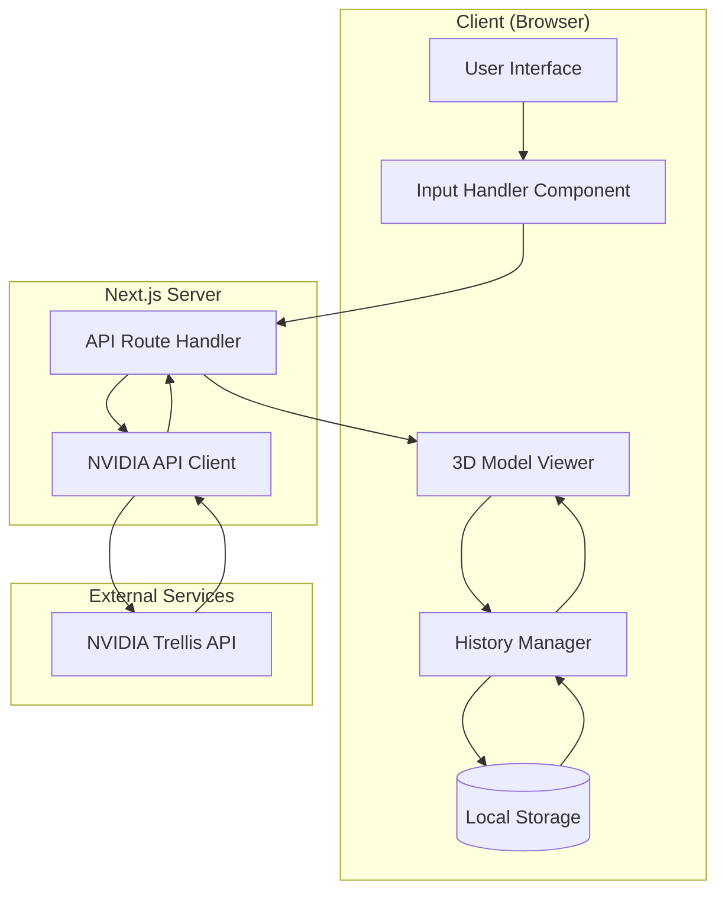

# Design Document: 3D Model Generator

## Overview

The 3D Model Generator is a Next.js web application that enables users to generate 3D models from images or text descriptions using NVIDIA's Trellis API. The system provides an intuitive interface for input selection, real-time 3D model visualization with interactive controls, and maintains a history of generated models in browser storage.

The application follows a client-server architecture where the Next.js frontend handles user interaction and 3D rendering, while API routes securely communicate with the NVIDIA Trellis API. The design emphasizes security (API key protection), user experience (loading states, error handling), and performance (efficient 3D rendering).

## Architecture

### System Architecture



### Component Architecture

The application is structured into the following layers:

1. **Presentation Layer**: React components for UI, input handling, and 3D visualization
2. **API Layer**: Next.js API routes for secure server-side API communication
3. **Storage Layer**: Browser LocalStorage for generation history persistence
4. **External Integration Layer**: NVIDIA Trellis API client

### Technology Stack

- **Frontend Framework**: Next.js 16.2.3 with React 19.2.4
- **3D Rendering**: React Three Fiber (@react-three/fiber) with Three.js
- **3D Controls**: @react-three/drei for camera controls and helpers
- **Styling**: Tailwind CSS 4
- **Type Safety**: TypeScript 5
- **API Communication**: Native fetch API
- **Storage**: Browser LocalStorage API

## Components and Interfaces

### 1. Input Handler Component

**Purpose**: Manages user input selection and processing for both image and text modes.

**Props Interface**:
```typescript
interface InputHandlerProps {
  onSubmit: (input: GenerationInput) => Promise<void>;
  isLoading: boolean;
}

type GenerationInput = 
  | { type: 'image'; data: string; preview: string }
  | { type: 'text'; data: string };
```

**Key Responsibilities**:
- Toggle between image upload and text input modes
- Validate and encode image files to base64
- Enforce text character limits (500 characters)
- Display input previews and character counts
- Handle file size validation (max 10MB)

**State Management**:
```typescript
interface InputHandlerState {
  mode: 'image' | 'text';
  imageFile: File | null;
  imagePreview: string | null;
  textInput: string;
  error: string | null;
}
```

### 2. API Route Handler

**Purpose**: Server-side endpoint for secure communication with NVIDIA Trellis API.

**Endpoint**: `POST /api/generate-model`

**Request Interface**:
```typescript
interface GenerateModelRequest {
  type: 'image' | 'text';
  data: string; // base64 image or text prompt
}
```

**Response Interface**:
```typescript
interface GenerateModelResponse {
  success: boolean;
  model?: {
    data: string; // 3D model data (GLB format)
    format: 'glb';
  };
  error?: {
    message: string;
    code: string;
  };
}
```

**Configuration**:
- Authentication: Bearer token from `NVIDIA_API_KEY` environment variable
- Endpoint: `https://ai.api.nvidia.com/v1/genai/microsoft/trellis`
- Timeout: 60 seconds
- Max retries: 0 (handled by client)

### 3. NVIDIA API Client

**Purpose**: Encapsulates communication logic with NVIDIA Trellis API.

**Interface**:
```typescript
interface TrellisAPIClient {
  generateModel(params: GenerationParams): Promise<ModelData>;
}

interface GenerationParams {
  image?: string; // base64 encoded
  text?: string;
  slat_cfg_scale: number; // 3
  ss_cfg_scale: number; // 7.5
  slat_sampling_steps: number; // 25
  ss_sampling_steps: number; // 25
  seed: number; // 0
}

interface ModelData {
  data: string; // GLB format model data
  metadata?: {
    generatedAt: string;
    inputType: 'image' | 'text';
  };
}
```

**Error Handling**:
- Network errors: Retry with exponential backoff (client-side)
- Authentication errors: Return 401 with configuration message
- API errors: Parse and return descriptive error messages
- Timeout errors: Return 408 with timeout message

### 4. Model Viewer Component

**Purpose**: Renders and enables interaction with 3D models using React Three Fiber.

**Props Interface**:
```typescript
interface ModelViewerProps {
  modelData: string | null; // GLB data URL
  onLoadError?: (error: Error) => void;
  onLoadSuccess?: () => void;
}
```

**Features**:
- Orbit controls for rotation (mouse drag)
- Zoom controls (scroll/pinch)
- Pan controls (right-click drag or two-finger drag)
- Reset view button
- Automatic camera positioning to fit model
- Lighting setup (ambient + directional lights)
- Performance monitoring (target 30+ FPS)

**3D Scene Configuration**:
```typescript
interface SceneConfig {
  camera: {
    position: [number, number, number]; // [5, 5, 5]
    fov: number; // 50
  };
  lights: {
    ambient: { intensity: number }; // 0.5
    directional: { 
      intensity: number; // 1
      position: [number, number, number]; // [10, 10, 5]
    };
  };
  controls: {
    enableDamping: boolean; // true
    dampingFactor: number; // 0.05
    minDistance: number; // 2
    maxDistance: number; // 20
  };
}
```

### 5. History Manager Component

**Purpose**: Manages generation history storage and retrieval.

**Interface**:
```typescript
interface HistoryManager {
  addGeneration(item: HistoryItem): void;
  getHistory(): HistoryItem[];
  selectGeneration(id: string): HistoryItem | null;
  clearHistory(): void;
}

interface HistoryItem {
  id: string;
  timestamp: number;
  inputType: 'image' | 'text';
  inputData: string; // original input
  modelData: string; // GLB data
  thumbnail?: string; // base64 image thumbnail
}
```

**Storage Strategy**:
- Use LocalStorage with key: `3d-model-history`
- Limit to 10 most recent generations
- Implement LRU eviction when limit exceeded
- Store compressed model data if size exceeds 5MB
- Handle storage quota exceeded errors gracefully

### 6. Main Page Component

**Purpose**: Orchestrates all components and manages application state.

**State Interface**:
```typescript
interface AppState {
  currentModel: string | null;
  isGenerating: boolean;
  error: string | null;
  retryCount: number;
  lastInput: GenerationInput | null;
  selectedHistoryId: string | null;
}
```

## Data Models

### Generation Request Payload

```typescript
interface TrellisGenerationRequest {
  // Input (one of these required)
  image?: string; // base64 encoded image
  text?: string; // text prompt
  
  // Fixed parameters (as per requirements)
  slat_cfg_scale: 3;
  ss_cfg_scale: 7.5;
  slat_sampling_steps: 25;
  ss_sampling_steps: 25;
  seed: 0;
}
```

### API Response Format

```typescript
interface TrellisAPIResponse {
  // Success response
  model?: {
    data: string; // Base64 encoded GLB file
    format: 'glb';
  };
  
  // Error response
  error?: {
    code: string;
    message: string;
    details?: unknown;
  };
}
```

### LocalStorage Schema

```typescript
interface StoredHistory {
  version: 1;
  items: HistoryItem[];
  lastUpdated: number;
}
```

## Correctness Properties

*A property is a characteristic or behavior that should hold true across all valid executions of a system—essentially, a formal statement about what the system should do. Properties serve as the bridge between human-readable specifications and machine-verifiable correctness guarantees.*

Before defining properties, I need to analyze the acceptance criteria for testability using the prework tool.

