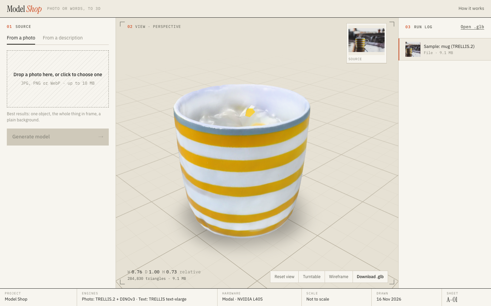

# Model Shop

Turn a photo or a short description into a 3D model you can turn, inspect and download.
Model Shop runs open models on your own rented GPU: Microsoft's TRELLIS.2 for photos (it reads
the photo with Meta's DINOv3) and TRELLIS text-xlarge for descriptions.



## What it does

- **Photo to 3D.** Drop in a JPG, PNG or WebP of one object. You get a textured 3D model (GLB).
- **Description to 3D.** Describe one object in a sentence. Same result, from words.
- **Inspect.** Turn and zoom, turntable, wireframe, reset view. The corner readout shows proportions, triangle count and file size, with the source photo pinned beside the model.
- **Keep.** Download any result as `.glb`, open any `.glb` from your computer, and click back through every model made in the tab.
- **Honest waiting.** A cold GPU takes 2.5 to 4.5 minutes. The page shows elapsed time against the usual window instead of a made-up progress bar.

The interface is laid out like an architect's drawing sheet (title block, crop marks, hatching, a scale bar), because the long-term goal is buildings: see [Roadmap](#roadmap).

## How it works

```
browser ──> Next.js API route ──> Modal web endpoint ──> NVIDIA L40S GPU ──> GLB back to the viewer
            app/api/generate-model   checks the API key     TRELLIS.2 (photo) or
                                     on a small CPU first   TRELLIS text-xlarge (text)
```

For a photo, TRELLIS.2 works in four steps:

1. **Read the photo.** The background is cut away (BiRefNet), then Meta's DINOv3 vision model turns the photo into features.
2. **Block out.** The model decides which cells of a coarse 3D grid the object fills.
3. **Detail.** Inside those cells it adds fine shape and surface colour.
4. **Export.** The result becomes a triangle mesh with a painted texture, saved as one `.glb` file.

Descriptions skip step 1: the words steer steps 2 and 3, read by CLIP instead of DINOv3.

## Models we compared

Same three photos, same GPU (L40S), seed 42. Seconds of GPU work once the model is loaded:

| Model | Cut-out example | Carved chair | Mug | Notes |
|---|---:|---:|---:|---|
| **TRELLIS.2** (Microsoft) | 133 | 48 | 91 | In use for photos. Largest files (300,000 faces, 2048 px texture). |
| TRELLIS v1 (Microsoft) | 52 | 26 | 24 | Fastest, smallest files (1024 px texture). |
| Hunyuan3D-2.1 (Tencent) | 104 | 90 | 80 | PBR textures; reduces to 40,000 faces. |

A cold start adds about two minutes on top (most of it is waiting for Modal to hand over a GPU).

## Run it yourself

You need: Node (current LTS, through nvm), [pnpm](https://pnpm.io), a [Modal](https://modal.com) account with the `modal` CLI (version 1.6.x; see the note below), and a [Hugging Face](https://huggingface.co) account.

**1. Get access to DINOv3.** TRELLIS.2 needs Meta's gated model
[`facebook/dinov3-vitl16-pretrain-lvd1689m`](https://huggingface.co/facebook/dinov3-vitl16-pretrain-lvd1689m).
Request access on that page while signed in to Hugging Face. Meta approves by hand, so it can take a while.
Then create a Hugging Face read token.

**2. Put the GPU side on Modal.** Pick any long random string as your API key.

```bash
modal secret create trellis-3d API_KEY=<your-random-key> HF_TOKEN=<your-hf-read-token>

modal run trellis_modal.py::check_imports    # CPU: builds the image, checks the libraries
modal run trellis_modal.py::download         # CPU: caches the weights in a Modal volume
modal deploy trellis_modal.py                # photo endpoint

modal run trellis1_modal.py::download_text   # CPU: text model weights
modal deploy trellis1_modal.py               # text endpoint
```

Each `deploy` prints an endpoint address ending in `.modal.run`.

**3. Point the app at it.** Create `.env.local` in the project root:

```env
MODAL_TRELLIS_URL=<photo endpoint address>
MODAL_TEXT_URL=<text endpoint address>
MODAL_TRELLIS_KEY=<your-random-key>
```

**4. Run.**

```bash
pnpm install
pnpm run build && pnpm run start     # http://localhost:3000, this computer only
```

Both scripts listen on 127.0.0.1 only, on purpose: anyone who can open the app can spend your GPU credits. Do not put it on a network or the internet without a login and rate limits in front of it.

### Costs and guards

An L40S costs about $1.95 an hour on Modal, plus a little CPU and memory. A cold photo run costs roughly $0.15 to $0.25; a warm one a few cents. Every Modal function keeps one GPU at most, shuts down after 60 seconds idle, caps each job at 10 minutes, and checks the API key on a CPU before any GPU starts. Set a spending limit in Modal's settings too.

To get faster runs for a demo, send one photo and one description about five minutes before. Photos and descriptions each have their own GPU, and each handles one job at a time.

**Note:** Modal CLI 1.7.0 and later refuses Python 3.10 images, which the TRELLIS scripts use. Stay on 1.6.x until they move to Python 3.11.

### Without Modal

If `MODAL_TRELLIS_URL` is not set, photos go to the public `microsoft/TRELLIS.2` Hugging Face Space (set `HF_TOKEN` in `.env.local`; the free quota is about one image a day). If `MODAL_TEXT_URL` is not set, descriptions go to NVIDIA's hosted Trellis (`NVIDIA_API_KEY`), which failed often in our tests.

## Project layout

| Path | What it is |
|---|---|
| `app/page.tsx` | The workbench: layout, run log, waiting panel, title block |
| `app/components/InputHandler.tsx` | Photo and description input |
| `app/components/ModelViewer.tsx` | 3D view (React Three Fiber): lighting, grid, camera fit, tools |
| `app/components/Notes.tsx` | The "How a photo becomes a model" sheet below the tool |
| `app/api/generate-model/route.ts` | Sends requests to Modal (or the fallbacks) and returns the GLB |
| `trellis_modal.py` | TRELLIS.2 on Modal: the photo endpoint |
| `trellis1_modal.py` | TRELLIS text-xlarge on Modal (the text endpoint), plus the TRELLIS v1 photo test |
| `hunyuan3d_modal.py` | Hunyuan3D-2.1 on Modal, used only for the comparison |
| `lib/cursor-swarm.js` | Vendored animation library that builds the notes sheet as you scroll |
| `public/samples/` | A ready-made TRELLIS.2 model of a mug, so the viewer can be tried without a GPU |

Built with Next.js 16, React 19, React Three Fiber and Three.js, TypeScript.

## Roadmap

- **Buildings.** The goal: architectural drawings and photos of buildings in, detailed building models out. Not tested yet. These models learned mostly from single objects, so whole buildings are the open question.
- Pick the best of the three models on quality, not just speed.
- Faster cold starts (cache compiled GPU kernels in the Modal volume).

## Credits

- [TRELLIS.2](https://github.com/microsoft/TRELLIS.2) and [TRELLIS](https://github.com/microsoft/TRELLIS) by Microsoft (MIT).
- [DINOv3](https://huggingface.co/facebook/dinov3-vitl16-pretrain-lvd1689m) by Meta (DINOv3 License, gated).
- [BiRefNet](https://huggingface.co/ZhengPeng7/BiRefNet) (MIT), for background removal.
- [Hunyuan3D-2.1](https://github.com/Tencent-Hunyuan/Hunyuan3D-2.1) by Tencent, compared only.
- [cursor-swarm.js](https://github.com/ZhengLinLei/cursor-swarm.js) by ZhengLinLei (MIT).
- Sample mug photo by Alexandru Stavrică (CC0).
