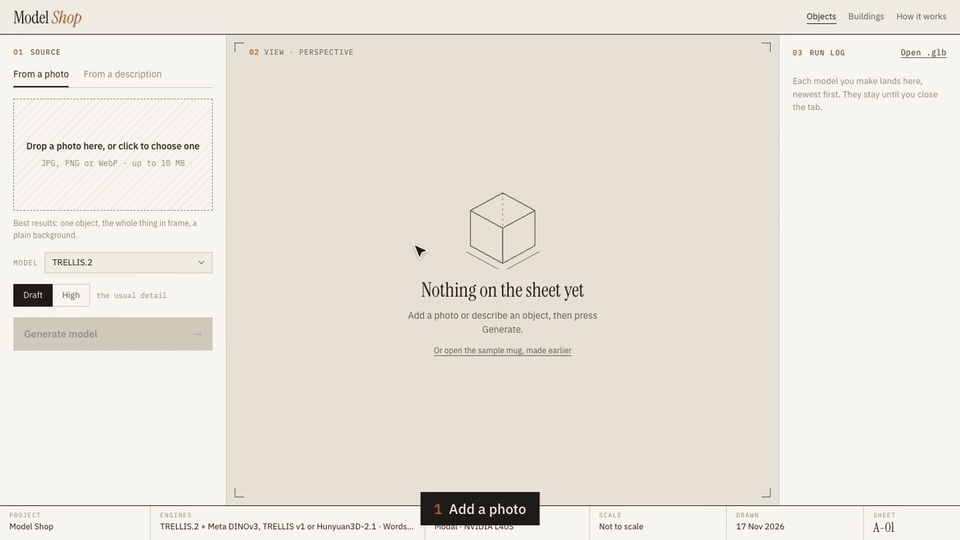
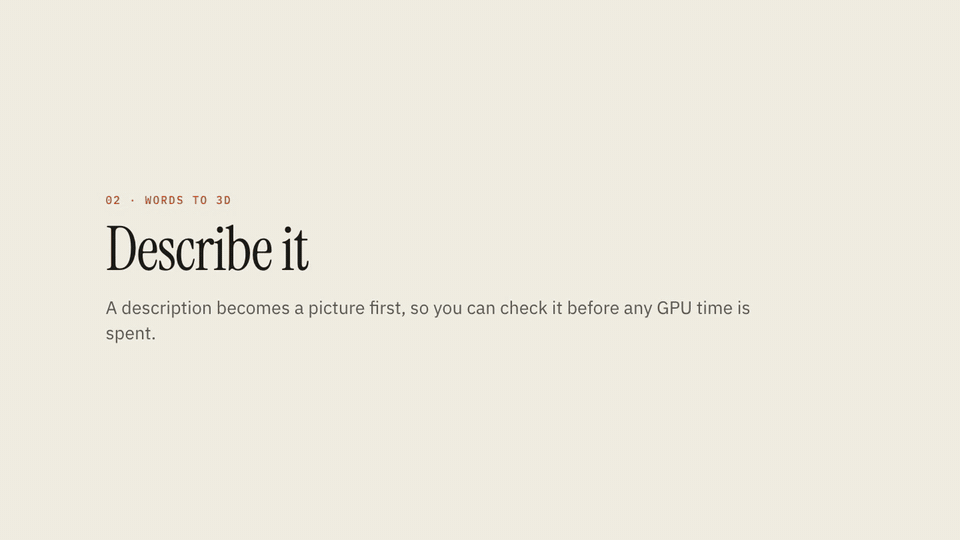
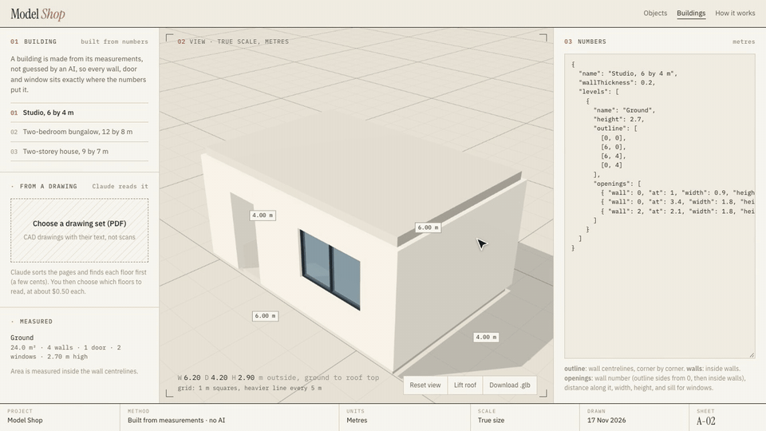
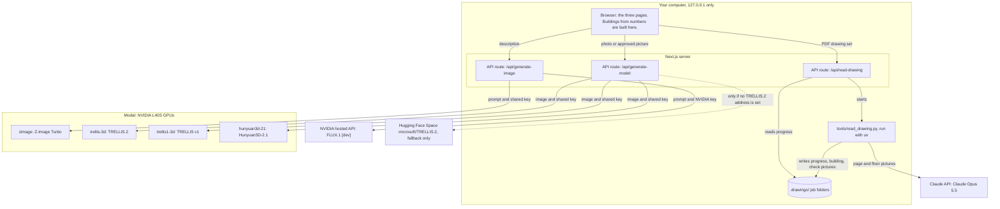

# Model Shop

Turn a photo or a short description into a 3D model you can turn, inspect and download.
Turn a building's measurements, or its CAD drawings (drawings made in computer-aided design software), into an exact 3D building at true size.

Model Shop is a web app that runs on your own computer and is reachable only from it.
The heavy AI work runs on rented GPUs (graphics cards that do the maths for AI models) on [Modal](https://modal.com), plus two hosted services: NVIDIA's API for one picture model and the Claude API for reading drawings.

**A photo becomes a 3D model**



**A description becomes a picture you check, then a 3D model**



**A building from its measurements** (or from its CAD drawings, read by Claude)



## Contents

- [What it does](#what-it-does)
- [How it works](#how-it-works)
- [The models](#the-models)
- [Set it up from scratch](#set-it-up-from-scratch)
- [Run it](#run-it)
- [Test it](#test-it)
- [Project structure](#project-structure)
- [Costs and speed](#costs-and-speed)
- [Security](#security)
- [Limitations](#limitations)
- [Credits](#credits)

## What it does

The app has three pages, linked from the header. Switching pages never drops a model that is still being made: the run log and the job on the GPU live in the shared page frame.

### Objects (`/`)

- **Photo to 3D.** Drop in one JPG, PNG or WebP photo (up to 10 MB) of one object. You get a textured 3D model as a GLB file (a single-file 3D format that most 3D tools open).
- **Description to 3D.** Describe one object in up to 500 characters. Your words first become a picture, and you check it before any 3D work starts. If the picture does not match, make another. If it does, it goes through the same path as a photo.
- **Choose the picture model.** Z-Image Turbo (the default, on your own Modal GPU) or FLUX.1 [dev] (hosted by NVIDIA).
- **Choose the 3D model.** TRELLIS.2 (the default), TRELLIS v1 or Hunyuan3D-2.1, each on its own GPU, so you can compare them on the same picture. A model whose address is not set up answers with an error; it never falls back to TRELLIS.2 quietly, so a comparison never compares TRELLIS.2 with itself.
- **Draft or High** (TRELLIS.2 only). Draft is the everyday setting. High uses TRELLIS.2's finest pass and Microsoft's example export settings (1,000,000 faces and 4096 px textures, against 300,000 faces and 2048 px for Draft): finer detail, about 3 times the time and file size.
- **Inspect.** Turn and zoom, turntable (a slow automatic spin), wireframe (shows the triangles the surface is made of), reset view. A corner readout shows the model's proportions (width, depth, height relative to each other: a generated model has no real size), its triangle count and its file size. The source photo stays pinned beside the model.
- **Keep.** Download any result as `.glb`, open any `.glb` from your computer, and click back through every model made in this browser tab. A ready-made sample mug opens without a GPU.
- **Honest waiting.** A clock shows the time spent so far. For TRELLIS.2 the page also shows the usual time window, for a cold GPU or a warm one, instead of a made-up progress bar.

### Buildings (`/buildings`)

- **A building typed as measurements.** You describe the building as numbers in metres, in JSON (a plain text format for structured data): the outline of each floor, the inside walls (each may give its own thickness), the doors and windows, the floor heights, and optionally the grid lines. Code in `lib/building.ts` turns those numbers into exact walls, glass, window frames and floor slabs. No AI is involved here, so nothing is guessed. Three samples are built in: a studio, a two-bedroom bungalow and a two-storey house.
- **Mistakes in plain words.** If the numbers do not make a valid building (a window longer than its wall, say), the page lists what to fix and keeps showing the last version that worked.
- **The 3D view.** True scale, the length of each outside wall labelled on the ground floor, the outside width, depth and height, a late-afternoon sun with shadows, lift the roof, show fewer floors, and download the building as `.glb`, or as `.ifc` for Revit. A per-floor summary gives each floor's area, walls, doors, windows and height.
- **For Revit.** The `.ifc` download is IFC2X3, the open building-model format Revit links and opens. It carries what a Revit user sets out from: storeys at their levels, walls along their centrelines with a wall type per thickness, doors and windows sitting in holes in their walls, floor slabs, the flat roof and the grid lines. It leaves out furniture, stairs, the parapet, the site and colours. `tools/to_ifc.py` writes it with IfcOpenShell, on this machine, for free. Tested in Revit only once: an earlier version of the sample bungalow (one wall type, no grid lines) was linked into Revit 2026 by a civil engineer, and nobody looked closely at the result. Grid lines, levels and wall types have not been seen in Revit yet, and neither has opening the file as real Revit walls.
- **From a drawing.** Upload a CAD drawing set as a PDF (up to 200 MB). Claude Opus 5.5 reads it floor by floor into the same numbers, and the building appears in the viewer. You choose which floors to read, with a price shown before anything costly starts. Each floor gets a check picture: the reading drawn in colour over the original plan (blue walls, orange doors, purple windows, red furniture), so you can see at a glance what was read right and what was missed.

### How it works (`/how-it-works`)

A notes sheet, drawn on screen by animated cursors, that explains in four steps how a photo becomes a model, and compares the three 3D models.

## How it works



The browser only ever talks to the app's own server, through its API routes (small server functions the pages call). The server, and the reader script it starts on the same computer, hold every key and make every outside call, so no key reaches the browser.

### A photo becomes a model (TRELLIS.2)

1. **Read the photo.** The background is cut away (BiRefNet), then Meta's DINOv3 vision model turns the photo into features: numbers that describe what is in it.
2. **Block out.** The model decides which cells of a coarse 3D grid the object fills, like massing blocks on an architect's site model.
3. **Detail.** Inside those cells it adds the fine shape and the surface colour.
4. **Export.** The result becomes a triangle mesh (a surface made of many small triangles) with a painted texture, saved as one `.glb` file.

TRELLIS v1 follows the same idea with Meta's older DINOv2 as its reader. Hunyuan3D-2.1 works in two stages: it makes the shape first, then paints it from several generated views.

### A description becomes a model

Your words, plus a fixed instruction asking for one whole object on a plain white background, become a picture. You approve the picture, and it then takes the photo path above. The app does not use a text-to-3D model directly: Microsoft's TRELLIS README recommends this picture-first route, and in this project's tests the text model dropped material words (a concrete tower came out as timber).

### A drawing becomes a building

The reader is one Python script, `tools/read_drawing.py`. The app starts it in the background for each upload and polls its progress.

1. **Sort the pages.** Claude looks at small pictures of every sheet, 20 at a time, and lists the whole-floor plans and where each sits on its sheet.
2. **Find each floor (no AI).** From the PDF's text layer (the real, selectable text inside a PDF, as opposed to a picture of text) it finds the grid bubbles (the lettered and numbered circles at the ends of the structural grid lines) and the dimension numbers written between them, and measures the scale from those. The scale written on the sheet is never trusted. It also reads each floor's level mark, such as +2.80.
3. **Wait for you.** The page lists the floors found, with an estimated price, and waits for you to choose. Nothing costly starts unseen.
4. **Walls, doors and windows.** One Claude reading per floor, given the floor's picture plus the measured grid and scale.
5. **Furniture and fittings.** A second Claude reading per floor, given the walls already read, the drawing's tags and the legend pages.
6. **Stack and check.** The floors are stacked by their levels into one building, with the grid lines measured in step 2, and each reading is drawn over its plan as a check picture.

Steps 4 and 5 run on four floors at a time.

## The models

All the GPU models run on NVIDIA L40S GPUs on Modal, one app per model, deployed from the `*_modal.py` files in this repository.

| Model | By | What it does here | Where it runs | Licence |
|---|---|---|---|---|
| [TRELLIS.2](https://huggingface.co/microsoft/TRELLIS.2-4B) ([code](https://github.com/microsoft/TRELLIS.2)) | Microsoft | Photo to 3D, the default | Modal (`trellis_modal.py`) | See its licence |
| [DINOv3](https://huggingface.co/facebook/dinov3-vitl16-pretrain-lvd1689m) | Meta | Reads the photo for TRELLIS.2. Gated: you must request access | Inside the TRELLIS.2 app | See its licence |
| [BiRefNet](https://huggingface.co/ZhengPeng7/BiRefNet) | ZhengPeng7 (Hugging Face) | Cuts the background away for TRELLIS.2 | Inside the TRELLIS.2 app | See its licence |
| [TRELLIS v1](https://huggingface.co/microsoft/TRELLIS-image-large) ([code](https://github.com/microsoft/TRELLIS)) | Microsoft | Photo to 3D, for comparison | Modal (`trellis1_modal.py`) | See its licence |
| [DINOv2](https://github.com/facebookresearch/dinov2) | Meta | Reads the photo for TRELLIS v1 | Inside the TRELLIS v1 app | See its licence |
| [Hunyuan3D-2.1](https://huggingface.co/tencent/Hunyuan3D-2.1) ([code](https://github.com/Tencent-Hunyuan/Hunyuan3D-2.1)) | Tencent | Photo to 3D with physically based textures (they describe how the surface reflects light, not only its colour), for comparison | Modal (`hunyuan3d_modal.py`) | See its licence |
| [Z-Image Turbo](https://huggingface.co/Tongyi-MAI/Z-Image-Turbo) | Alibaba (Tongyi) | Description to picture, the default | Modal (`zimage_modal.py`) | Apache 2.0 |
| [FLUX.1 [dev]](https://huggingface.co/black-forest-labs/FLUX.1-dev) | Black Forest Labs | Description to picture, the second choice | NVIDIA's hosted API | Non-commercial |
| [Claude Opus 5.5](https://platform.claude.com/docs/en/about-claude/models/overview) | Anthropic | Reads drawing sets into buildings | Claude API, called from `tools/read_drawing.py` | See its terms of use |

Helpers also downloaded by the apps: [rembg](https://github.com/danielgatis/rembg) with its u2net model (background removal for TRELLIS v1 and Hunyuan3D-2.1), [DINOv2 giant](https://huggingface.co/facebook/dinov2-giant) and [Real-ESRGAN](https://github.com/xinntao/Real-ESRGAN) (for Hunyuan3D-2.1). See each one's licence.

FLUX.1 [dev]'s weights (a model's learned numbers: the large files you download to run it) are for non-commercial use. Check NVIDIA's and Black Forest Labs' terms before any paid use.

Z-Image Turbo is the default picture model because, in a small test on 17 Nov 2026, it kept the materials named in the descriptions better than FLUX.1 [dev] did (FLUX turned a chair's steel legs into wood).

`trellis1_modal.py` also holds TRELLIS text-xlarge, a direct text-to-3D model. The pages no longer use it (see [Limitations](#limitations)).

## Set it up from scratch

The steps that run on a GPU cost the most. The build and download steps run on CPU machines (ordinary processors), which cost far less.

### 1. What you need

- **macOS or Linux.** Developed on macOS. The app cancels a drawing reading with a Unix process signal, which Windows lacks, so on Windows use WSL (Windows Subsystem for Linux).
- **Node.js through nvm** (a tool that installs and switches Node versions). The project pins Node 26, the current long-term-support (LTS) release, in `.nvmrc`; Next.js 16 needs Node 20.9 or later.
- **pnpm** (the package manager this project uses; never npm or npx). Install it from [pnpm.io](https://pnpm.io/installation).
- **uv** (a fast Python tool). The drawing reader runs through it, and it is an easy way to install the Modal command line tool. Install it from [docs.astral.sh/uv](https://docs.astral.sh/uv/).
- **A Modal account** ([modal.com](https://modal.com)), where the GPU apps run.
- **A Hugging Face account** ([huggingface.co](https://huggingface.co)), to download the gated DINOv3 weights.
- **An NVIDIA API key** from [build.nvidia.com](https://build.nvidia.com), only if you want FLUX.1 [dev] pictures.
- **An Anthropic API key** from the [Claude Console](https://platform.claude.com), only if you want to read drawings.

### 2. Get the code and the JavaScript packages

```bash
git clone https://github.com/ElikplimSunu/model-shop.git
cd model-shop
nvm install   # reads .nvmrc
nvm use
pnpm install
```

### 3. Install the Modal command line tool and log in

```bash
uv tool install "modal>=1.6,<1.7"
modal setup
```

`modal setup` opens your browser and saves a Modal token (the login for the command line tool) on your computer.

Stay on Modal 1.6.x for now: Modal 1.7.0 and later refuse the Python 3.10 images that the two TRELLIS apps are built on.

### 4. Get access to DINOv3 and make a Hugging Face token

TRELLIS.2 reads photos with Meta's gated model [`facebook/dinov3-vitl16-pretrain-lvd1689m`](https://huggingface.co/facebook/dinov3-vitl16-pretrain-lvd1689m). Sign in to Hugging Face, open that page and request access. Meta approves requests by hand, so this can take a while. Then create a read token in your Hugging Face settings.

The other models download without a token.

### 5. Create the shared secret on Modal

Every Modal app has web endpoints (web addresses that accept requests), and each one checks one shared key before it does any work. Pick a long random string as that key, for example with `openssl rand -hex 32`. Store it, with your Hugging Face token, in a Modal secret (Modal's encrypted store for keys) named `trellis-3d`:

```bash
modal secret create trellis-3d API_KEY=<your-random-key> HF_TOKEN=<your-hugging-face-read-token>
```

- `API_KEY` is checked by every web endpoint of all four apps.
- `HF_TOKEN` is used only by the TRELLIS.2 weight download.

Keep the same random key for step 7: the app sends it as `MODAL_TRELLIS_KEY`.

### 6. Build and deploy the GPU apps

Each app has three kinds of command. `check_imports` builds the app's software image and checks that its libraries load, on a cheap CPU machine. `download` caches the model weights in a Modal volume (a stored disk the GPU machines share), also on a CPU. `deploy` publishes the app's web endpoints and prints their addresses, which end in `.modal.run`.

**TRELLIS.2** (needed for photos):

```bash
modal run trellis_modal.py::check_imports
modal run trellis_modal.py::download
modal deploy trellis_modal.py
```

The address you need is the one for `generate`.

**Z-Image Turbo** (needed for the default picture model; it has no `check_imports`):

```bash
modal run zimage_modal.py::download
modal deploy zimage_modal.py
```

The address you need is the one for `generate`.

**TRELLIS v1** (optional, for the model picker):

```bash
modal run trellis1_modal.py::check_imports
modal run trellis1_modal.py::download
modal deploy trellis1_modal.py
```

This app has two endpoints. The address you need is the one for `generate_image`; `generate_text` belongs to the unused text model.

**Hunyuan3D-2.1** (optional, for the model picker):

```bash
modal run hunyuan3d_modal.py::check_imports
modal run hunyuan3d_modal.py::download
modal deploy hunyuan3d_modal.py
```

The address you need is the one for `generate`.

Deploying starts no GPU: a GPU starts only when a request with the right key arrives. Also set a spending limit in your Modal workspace settings.

### 7. Point the app at its services

Create a file named `.env.local` in the project folder. Next.js reads it when the server starts, and git ignores it, so your keys never reach the repository. Put one `NAME=value` per line. Restart the server after any change.

| Variable | Needed for | What it holds |
|---|---|---|
| `MODAL_TRELLIS_URL` | Photos with TRELLIS.2 | The `generate` address of `trellis_modal.py`. If it is missing, TRELLIS.2 photos go to the public Hugging Face Space instead (see below). |
| `MODAL_TRELLIS_KEY` | Every Modal call | The same random key you stored as `API_KEY` in step 5. The server sends it with each request. |
| `MODAL_ZIMAGE_URL` | Z-Image Turbo pictures | The `generate` address of `zimage_modal.py`. |
| `NVIDIA_API_KEY` | FLUX.1 [dev] pictures | Your NVIDIA API key. |
| `MODAL_TRELLIS1_URL` | TRELLIS v1 (optional) | The `generate_image` address of `trellis1_modal.py`. |
| `MODAL_HUNYUAN_URL` | Hunyuan3D-2.1 (optional) | The `generate` address of `hunyuan3d_modal.py`. |
| `ANTHROPIC_API_KEY` | Reading drawings | Your Anthropic API key. The server passes it on to the reader script. |
| `HF_TOKEN` | Optional | A Hugging Face read token, used only by the Hugging Face Space fallback. |
| `UV_BIN` | Optional | The full path to `uv`, if the server cannot find it on its own. |

A model or picture maker whose variable is missing answers with a message naming that variable; nothing else breaks. A wrong or missing `MODAL_TRELLIS_KEY` shows up as a 401 (not allowed) error from Modal.

**Without Modal.** If `MODAL_TRELLIS_URL` is not set, TRELLIS.2 photos go to Microsoft's public `microsoft/TRELLIS.2` Space (a demo app hosted on Hugging Face) (add `HF_TOKEN` to use your own account's quota). Its free quota is small, Draft and High do not apply there, and this path was not checked for this README.

## Run it

For everyday use, build once and start:

```bash
pnpm run build
pnpm run start
```

While changing the code, use the development server instead, which reloads on every save:

```bash
pnpm run dev
```

Both listen on [http://127.0.0.1:3000](http://127.0.0.1:3000), on this computer only.

- **First try, no GPU:** on the Objects page, open the sample mug.
- **Cold and warm.** Each model's GPU shuts down after 60 seconds without work. The first job after a pause starts cold and takes minutes; jobs right after it start warm. Before a demo, send one photo and one description a few minutes early.
- **One job at a time per model.** Each model keeps at most one GPU running, which handles one job at a time.

### Running the GPU apps from the command line

Each app can also run a batch of files directly, in one warm GPU container (a short-lived machine Modal starts for the job), with the results saved under `demo/` (ignored by git). These use GPU time.

```bash
modal run trellis_modal.py --images a.png,b.png
modal run trellis1_modal.py --images a.png,b.png
modal run hunyuan3d_modal.py --images a.png,b.png
modal run zimage_modal.py --prompts "a red chair|a brass lamp"
```

### Running the drawing reader from the command line

The page runs the reader for you. To run it by hand, make a job folder that holds the drawing set as `input.pdf`, then:

```bash
uv run tools/read_drawing.py <job folder>
```

It needs `ANTHROPIC_API_KEY` in the environment and writes `status.json`, `building.json` and `check-<n>.jpg` into the job folder. Development flags: `--stop-after sort` or `--stop-after find` stops early, `--yes` reads every floor found without waiting, `--only <names>` reads only the named plans, `--cap <dollars>` changes the spending cap (15 dollars unless you set it), and `--boxes <json>` skips step 1 with plan positions you already know.

## Test it

```bash
pnpm exec vitest run lib
```

This runs the tests for `lib/building.ts`: they measure the built pieces (wall lengths, door holes, window sills and frames, corners, slabs, basements, parapets, ground levels, fittings, floor areas) against the numbers they came from, and check the plain-word error messages, inside-wall thicknesses and grid lines. All 17 passed on 19 Nov 2026. They need no network and no keys.

```bash
uv run --quiet tools/check_ifc.py
```

This checks the `.ifc` writer on the three samples and two harder buildings (thin inside walls with grid lines; three storeys over a basement). Each file must pass IfcOpenShell's validator with the IFC2X3 rules, and read back as 3D at the right size and height, with every wall on its floor at its own thickness, every door and window inside its own hole, and each grid line at its place with its name. All five passed on 19 Nov 2026. Give it building files to check those instead.

```bash
pnpm exec vitest run
```

This runs every test file; today the `lib` tests above are the only ones. `pnpm test` starts the same runner in watch mode (it reruns the tests whenever a file changes).

```bash
pnpm run lint
pnpm exec tsc --noEmit
```

Lint (a scan for common code mistakes) and type checks (TypeScript checking that every value is used as its declared type). Both report errors in the three old test files; lint also flags one old line in `app/api/generate-model/route.ts`.

**On Modal**, `modal run <file>::check_imports` is a cheap check, on a CPU, that an app's image builds and its libraries load.

There is no CI workflow (continuous integration: checks that run by themselves on every push) in this repository, so run these on your own machine before you push.

## Project structure

```text
app/
  layout.tsx                    Page frame: fonts, tab titles, the shared header
  workshop.tsx                  Header and page links; holds the run log and the GPU job across pages
  page.tsx                      Objects page, with the waiting panel and run log
  buildings/page.tsx            Buildings page: samples, the numbers editor, the floor summary
  buildings/layout.tsx          The Buildings tab title
  how-it-works/page.tsx         How it works page
  api/generate-image/route.ts   Description to picture (Z-Image Turbo or FLUX.1 [dev])
  api/generate-model/route.ts   Picture to GLB (Modal, or the Hugging Face Space fallback)
  api/read-drawing/route.ts     Upload a PDF, start the reader, report progress, serve check pictures
  api/building-ifc/route.ts     Building numbers to an .ifc file, with tools/to_ifc.py
  components/InputHandler.tsx   Photo or description input, picture model, 3D model, Draft or High
  components/ModelViewer.tsx    3D view for objects (React Three Fiber)
  components/BuildingViewer.tsx 3D view for buildings: true scale, labels, sun, GLB and IFC downloads
  components/DrawingUpload.tsx  The From a drawing panel: upload, choose floors, progress, check pictures
  components/Notes.tsx          The How it works sheet
  icon.svg, apple-icon.png      Browser tab and home screen icons
  globals.css                   All styles
lib/
  building.ts                   A building as numbers, turned into exact 3D pieces; plain-word checks
  building.test.ts              Tests for building.ts
  cursor-swarm.js               Animation library that draws the How it works sheet (vendored: copied in, not installed)
types/3d-model.ts               Request types, and the lists of 3D models and picture models
tools/read_drawing.py           The drawing reader (Python, run with uv)
tools/to_ifc.py                 A building to IFC2X3 for Revit (IfcOpenShell, run with uv)
tools/check_ifc.py              Checks to_ifc.py on five buildings: validator rules, sizes, walls, holes, grids
trellis_modal.py                TRELLIS.2 on Modal, with Draft and High
trellis1_modal.py               TRELLIS v1 on Modal (and the unused text model)
hunyuan3d_modal.py              Hunyuan3D-2.1 on Modal
zimage_modal.py                 Z-Image Turbo on Modal
public/samples/                 The sample mug: its photo and a ready-made TRELLIS.2 model
docs/                           Images for this README
```

Created while the app runs, and ignored by git: `.drawings/` (each uploaded drawing set, its progress, its building and its check pictures) and `demo/` (output of the command line runs).

### A building as numbers

This is the first sample, a 6 by 4 metre studio. Points are in metres on the plan (x to the right, y up the sheet).

```json
{
  "name": "Studio, 6 by 4 m",
  "wallThickness": 0.2,
  "levels": [{
    "name": "Ground", "height": 2.7,
    "outline": [[0, 0], [6, 0], [6, 4], [0, 4]],
    "openings": [
      { "wall": 0, "at": 1, "width": 0.9, "height": 2.1, "kind": "door" },
      { "wall": 0, "at": 3.4, "width": 1.8, "height": 1.2, "sill": 0.9, "kind": "window" },
      { "wall": 2, "at": 2.1, "width": 1.8, "height": 1.2, "sill": 0.9, "kind": "window" }
    ]
  }]
}
```

- `outline`: the centrelines (the middle line through the wall's thickness) of the outside walls, corner by corner, as a closed loop.
- `walls`: inside walls, each as a start point and an end point.
- `openings`: `wall` is the wall's number (outline sides first, counting from 0, then inside walls), `at` is the distance along that wall to the opening's near edge, then `width`, `height`, and `sill` (the height of a window's bottom edge above the floor).
- `levels` stack from the bottom. A building can also have `fixtures` (furniture and fittings), `base` (a first floor below ground, for basements), `parapet` (a low wall round the roof edge), `balustrade` (glass on top of the parapet), `site` (ground levels around the building) and `colors`. The `Building` type in `lib/building.ts` describes every field.

## Costs and speed

All figures were measured on this project, with one or a few runs each; the single runs are marked. Treat them as rough guides, not benchmarks. All GPUs are NVIDIA L40S on Modal. A cold GPU is one that has to start up first; a warm one is still running from a job less than a minute before.

| What | Time or cost |
|---|---|
| TRELLIS.2 Draft, cold GPU, through the app | 4 to 6 minutes |
| TRELLIS.2 Draft, warm GPU | Much faster than cold |
| TRELLIS.2 High | About 3 times Draft |
| TRELLIS v1, cold GPU | 2:11 (one run) |
| Hunyuan3D-2.1, cold GPU | 3:38 and 3:48 (two runs) |
| Z-Image Turbo picture, cold GPU | 41 seconds to about 3.5 minutes |
| Z-Image Turbo picture, warm GPU | 4 to 5 seconds |
| FLUX.1 [dev] picture | About 10 to 30 seconds |
| Claude reading a drawing | About $0.50 a floor |
| A whole 12-floor drawing set | 11 minutes, $5.91 (one run) |

**How good the drawing readings are.** The test drawing set was a 12-floor office building drawing set (third-party, not in the repository). On two of its floors, the app's readings scored 0.95 against readings checked by hand. The score runs from 0 (nothing matches) to 1 (every wall, door, window and piece of furniture matches).

**Why Claude reads the drawings.** In a separate test on the same two floors, with the same instructions and pictures, Claude Opus 5.5 scored 0.97, against 0.33 for Qwen3-VL-32B and 0.16 for Qwen3-VL-8B, two open vision models run on Modal. One run each, with the open models untuned.

**Spending guards in the code.**

- Each model keeps at most one GPU running, shuts it down after 60 seconds idle, and caps each job (10 minutes for TRELLIS.2 and TRELLIS v1, 15 for Hunyuan3D-2.1, 5 for Z-Image Turbo).
- The download step caches the weights in Modal volumes, so GPU time is not spent downloading them. The TRELLIS.2 and Hunyuan3D-2.1 GPU machines run with downloads turned off, so a missing file fails at once instead of downloading on GPU time.
- The drawing reader asks before reading any floor and stops at 15 dollars per drawing set. Each Claude call books its worst-case cost against that cap before it starts, so floors read in parallel cannot overshoot it.

## Security

- **Local only, on purpose.** Both `pnpm run dev` and `pnpm run start` listen on 127.0.0.1, so only this computer can open the app. (By default, Next.js accepts connections from other devices on the network; the `-H 127.0.0.1` in `package.json` turns that off.) The app has no login and no rate limits, and anyone who can open it can spend your GPU and API credit. Do not put it on a network or the internet without both in front of it.
- **No GPU starts for a stranger.** The Modal endpoints are public web addresses, so each one first checks the shared key on a small CPU machine. The check uses a constant-time comparison (one that takes the same time however close a guess is, so the key cannot be worked out by timing). A wrong or missing key gets an error, and no GPU starts. Empty or oversized requests are refused the same way, also before any GPU starts.
- **No keys in the repository.** Keys live in `.env.local` and in the Modal secret, and git ignores every `.env*` file. Only the server reads the keys; none is sent to the browser.
- **What leaves your computer.** Photos and approved pictures go to your Modal apps (or to the Hugging Face Space, in the fallback). Descriptions go to your Modal Z-Image app or to NVIDIA. For a drawing, pictures of every page, and then of each floor you choose, go to the Claude API with the drawing's tags and legend text.
- **Uploaded drawing files stay on your computer.** The PDF, its progress, its building and its check pictures are saved under `.drawings/`, which git ignores. The server accepts only files that start like a PDF, reads one drawing at a time, and serves back only check pictures whose names match the expected pattern.

## Limitations

**Objects**

- One object per photo or description. The sides a photo does not show are guessed.
- Generated models have no real-world size; the readout shows proportions only.
- Results live only in the browser tab. Close it and they are gone, so download what you want to keep.
- Cold GPUs take minutes, and each model handles one job at a time.
- The usual time window is shown for TRELLIS.2 only. Draft and High exist for TRELLIS.2 only.
- A Z-Image Turbo picture request gives up after 5 minutes, and a FLUX.1 [dev] request after 3. A cold Z-Image Turbo start has taken about 3.5 minutes, which leaves little room.
- FLUX.1 [dev] is for non-commercial use.
- `generate_text` in `trellis1_modal.py`, the old direct text-to-3D model, is a leftover: the app no longer calls it.

**Buildings**

- Straight walls and flat roofs only. Doors are openings without door leaves. Furniture and fittings are simple boxes.
- The ground around a building is cut out by its bounding box (the smallest rectangle that holds the whole plan), so an L-shaped plan leaves bare ground in its inner corner.

**Drawings**

- Only CAD PDFs with a text layer. Scans, and PDFs whose text was turned into shapes, cannot be measured.
- The scale comes from dimension numbers written between grid lines. A set that writes its grid dimensions another way gets a warning, and its floors are left unticked.
- A floor without a level mark is placed between its neighbours: a guess, and the page says so.
- Readings must be checked against the check pictures. Doors are the weakest part.
- Inside-wall thickness is read wall by wall. On the scored set (three walls checked by eye per floor) it was right on one floor and 5 cm too thin on the other. Outside walls share one thickness.
- A building read from drawings is plainer than a hand-typed one: no site, colours or facade (outside face) details. A floor that fails keeps its place, with its neighbour's outline and no inside walls.
- Accuracy has been scored on two floors of one drawing set. The hand-checked readings were first drafted with Claude's help, which may favour Claude in the comparison with the open models.
- One reading at a time. If no floors are chosen within 30 minutes, the reading stops.

**Running it**

- One computer only, with no login, accounts or rate limits (see [Security](#security)).
- Modal CLI 1.7.0 and later refuse the TRELLIS apps' Python 3.10 images.
- There is no CI. The pages have no automatic tests in the repository; they have been checked in the browser.

## Credits

**Models**: TRELLIS.2 and TRELLIS by Microsoft; DINOv3 and DINOv2 by Meta; BiRefNet; Hunyuan3D-2.1 by Tencent; Z-Image Turbo by Alibaba's Tongyi lab; FLUX.1 [dev] by Black Forest Labs, through NVIDIA's hosted API; Claude Opus 5.5 by Anthropic; rembg and Real-ESRGAN. Links are in [The models](#the-models). Qwen3-VL by Alibaba's Qwen team was tested against Claude but is not used.

**Libraries**: [Next.js](https://nextjs.org), [React](https://react.dev), [three.js](https://threejs.org), [React Three Fiber and drei](https://github.com/pmndrs/react-three-fiber), [Tailwind CSS](https://tailwindcss.com), [Gradio's JavaScript client](https://www.npmjs.com/package/@gradio/client) (for the Hugging Face fallback), [Modal](https://modal.com) and FastAPI for the GPU apps, and [pdfplumber](https://github.com/jsvine/pdfplumber), Pillow and Anthropic's Python SDK for the drawing reader. Tests use [Vitest](https://vitest.dev) and Testing Library.

**Animation**: [cursor-swarm.js](https://github.com/ZhengLinLei/cursor-swarm.js) by ZhengLinLei, vendored in `lib/cursor-swarm.js` with its licence notice at the top of the file.

**Fonts**: IBM Plex Sans, IBM Plex Mono and Instrument Serif, through Google Fonts.

**Photos**

- The chair photo in the GIFs: ["Carved wooden chair (2), Williamson Art Gallery"](https://commons.wikimedia.org/wiki/File:Carved_wooden_chair_(2),_Williamson_Art_Gallery.jpg), by Reptonix, CC BY 3.0, Wikimedia Commons.
- The sample mug photo: ["Bucharest mug (Unsplash)"](https://commons.wikimedia.org/wiki/File:Bucharest_mug_(Unsplash).jpg), by Alexandru Stavrică, CC0, Wikimedia Commons.

**Test drawings**: a 12-floor office building drawing set (third-party, not in the repository).
